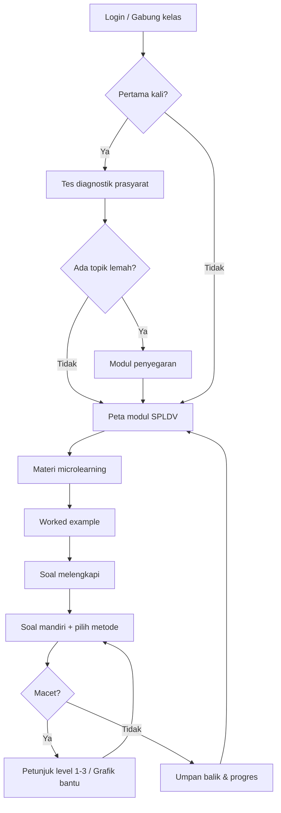

# 02 — Product Requirements Document (PRD)

| Atribut | Nilai |
|---|---|
| Produk | LangkahKu — Aplikasi Belajar SPLDV |
| Versi dokumen | 1.0 |
| Tanggal | 9 November 2026 |
| Pemilik produk | Riki Agil Saputra |
| Status | Draf untuk ditinjau |

---

## 1. Ringkasan

LangkahKu adalah aplikasi web (PWA) dan Android untuk membantu siswa SMP memahami dan menyelesaikan **Sistem Persamaan Linear Dua Variabel (SPLDV)**. Desainnya didasarkan pada **Cognitive Load Theory**: mengurangi beban ekstrinsik (instruksi panjang, penyajian abstrak), mengelola beban intrinsik (prasyarat, langkah bertahap), dan mendorong beban germane (contoh berpola, catatan, penjelasan sendiri). Guru mendapat dashboard untuk memantau progres dan titik kesulitan siswa.

Aplikasi juga bertujuan **menumbuhkembangkan literasi matematika** (kerangka PISA 2022 dan AKM Numerasi), yaitu kemampuan merumuskan situasi nyata menjadi model matematika, menyelesaikannya, lalu menafsirkan hasilnya. Untuk itu tersedia **pemodel soal cerita** dengan dua mode: siswa memodelkan sendiri secara terpandu, dan **AI (Claude API)** mengubah soal cerita SPLDV apa pun menjadi model yang diverifikasi SymPy lalu diselesaikan langkah demi langkah. Lihat [13-MATH-LITERACY.md](13-MATH-LITERACY.md) dan [14-WORD-PROBLEM-MODELER.md](14-WORD-PROBLEM-MODELER.md).

## 2. Latar Belakang & Masalah

Wawancara siswa (lihat [01-RESEARCH-INSIGHTS.md](01-RESEARCH-INSIGHTS.md)) menunjukkan bahwa siswa:

1. tidak memahami makna variabel dan kesulitan menentukan nilainya;
2. mencampuradukkan langkah metode substitusi, eliminasi, dan grafik;
3. macet di tengah penyelesaian karena tidak tahu langkah berikutnya;
4. lemah di materi prasyarat (operasi bilangan bulat, persamaan, perpangkatan);
5. terbebani oleh instruksi panjang dan penjelasan abstrak;
6. justru terbantu oleh grafik Kartesius, catatan sendiri, dan contoh soal berpola.

**Pernyataan masalah:** *Siswa SMP kesulitan menyelesaikan SPLDV karena penyajian materi yang abstrak dan padat membebani memori kerja mereka, sementara bantuan langkah demi langkah tidak tersedia saat mereka belajar mandiri.*

## 3. Tujuan & Metrik Keberhasilan

| ID | Tujuan | Metrik | Target MVP |
|---|---|---|---|
| G1 | Siswa mampu menyelesaikan SPLDV secara mandiri | Rata-rata skor soal mandiri modul SPLDV | ≥ 70 |
| G2 | Siswa tidak bergantung pada petunjuk | Penurunan penggunaan petunjuk level 3 dari sesi ke-1 ke sesi ke-3 | ≥ 40% |
| G3 | Siswa menyelesaikan alur belajar | Persentase siswa aktif yang menyelesaikan modul SPLDV | ≥ 80% |
| G4 | Prasyarat membaik | Kenaikan skor diagnostik ulang setelah penyegaran | ≥ 20 poin |
| G5 | Beban kognitif terasa rendah | Skor skala beban kognitif subjektif (Paas, 1–9) pada uji pengguna | ≤ 5 rata-rata |
| G6 | Guru terbantu | Guru dapat menemukan siswa & langkah tersulit | ≤ 2 menit dari login |
| G7 | Literasi matematika tumbuh | Kenaikan skor pretes → postes soal literasi gaya AKM | ≥ 15 poin |
| G8 | Siswa mampu memodelkan soal cerita | Rata-rata skor indikator *merumuskan* pada soal L1 | ≥ 70 |
| G9 | Pemodel AI andal | Akurasi model terverifikasi pada set evaluasi; model salah yang lolos verifikasi | ≥ 95%; ≤ 1% |

## 4. Pengguna Sasaran

| Peran | Deskripsi | Perangkat utama |
|---|---|---|
| **Siswa** | SMP kelas 8–9 yang mempelajari/mengulang SPLDV | HP Android (Android 8+), browser |
| **Guru** | Guru Matematika SMP | Laptop/PC (browser), HP |
| **Admin** | Pengelola sistem (pengembang) | Browser |

Persona lengkap: [01-RESEARCH-INSIGHTS.md §4](01-RESEARCH-INSIGHTS.md#4-persona).

## 5. Ruang Lingkup

### 5.1 Dalam Lingkup (MVP)

- Autentikasi berbasis peran (siswa, guru, admin)
- Manajemen kelas oleh guru; siswa bergabung via kode kelas
- Tes diagnostik prasyarat & modul penyegaran
- Modul SPLDV lengkap (PLDV, konsep SPLDV, metode Grafik, Substitusi, Eliminasi, Campuran, soal cerita)
- Solver terpandu langkah demi langkah dengan petunjuk 3 level
- Grafik Kartesius interaktif
- Latihan berpola dengan generator angka
- Catatan pribadi
- Dashboard guru + ekspor CSV
- PWA (web) & APK Android; materi dapat diakses offline setelah diunduh
- Literasi matematika: siklus pemodelan terpandu, bank soal literasi L1–L3 beragam konteks dan format AKM, profil literasi
- Pemodel soal cerita SPLDV otomatis berbasis AI (Claude API) dengan verifikasi SymPy, kontrol guru, dan fitur buat soal sendiri

### 5.2 Di Luar Lingkup (MVP)

- Materi selain SPLDV & prasyaratnya (SPLTV, kuadrat, dll.)
- Rilis iOS
- Chat/forum siswa, fitur sosial, papan peringkat publik
- Pengenalan tulisan tangan / foto soal (foto soal direncanakan v1.2)
- Chatbot/tutor AI percakapan bebas. AI hanya dipakai untuk menerjemahkan soal cerita menjadi model terstruktur (FR-22)
- Pemodelan otomatis soal cerita di luar SPLDV (PLSV, perbandingan, SPLTV)
- Pembayaran / langganan
- Multi-bahasa (hanya Bahasa Indonesia)

## 6. Kebutuhan Fungsional

Prioritas: **M** = Must, **S** = Should, **C** = Could (MoSCoW).

| ID | Kebutuhan | Prioritas | Temuan |
|---|---|---|---|
| FR-01 | **Autentikasi & peran.** Login dengan username + password. Peran: siswa, guru, admin. Siswa tidak wajib email. Guru mendaftar dengan email; akun guru diverifikasi admin. | M | — |
| FR-02 | **Manajemen kelas.** Guru membuat kelas (nama, jenjang), mendapat kode kelas 6 karakter, dapat membuat akun siswa massal (CSV) atau siswa bergabung sendiri via kode kelas. Guru dapat mereset password siswa. | M | — |
| FR-03 | **Tes diagnostik prasyarat.** 10 soal (bilangan bulat, persamaan linear satu variabel, perpangkatan sederhana, koordinat Kartesius, fungsi y = f(x)). Hasil per topik + rekomendasi modul penyegaran. Dapat diulang. | M | K03, IL03 |
| FR-04 | **Modul penyegaran prasyarat.** 4 submodul singkat: operasi bilangan bulat, persamaan linear satu variabel, koordinat Kartesius, fungsi y = f(x) (cara memperoleh y jika x diketahui). | M | IL03, DS02 |
| FR-05 | **Materi microlearning.** Materi disajikan per layar (1 konsep/layar), instruksi ≤ 25 kata, navigasi "Kembali/Lanjut" tanpa auto-advance, kotak "Ingat kembali" yang menautkan ke prasyarat terkait. | M | EL02, EL04, EL05, GL02 |
| FR-06 | **Kartu metode.** Setiap metode (Grafik, Substitusi, Eliminasi, Campuran) punya kartu ringkas dengan ikon, warna identitas, dan langkah bernomor (maks. 4 langkah). Tersedia tabel perbandingan metode dan pilihan metode saat mengerjakan soal. | M | IL02, IL05, DS01 |
| FR-07 | **Solver terpandu.** Soal dipecah menjadi langkah. Siswa mengisi tiap langkah; sistem memvalidasi kesetaraan matematis (SymPy) dan memberi umpan balik spesifik per jenis kesalahan (mis. salah tanda, salah kali). Warna x/y konsisten. | M | IL01, IL04, EL01 |
| FR-08 | **Petunjuk bertingkat.** Tombol "Petunjuk" per langkah dengan 3 level: (1) arah umum, (2) langkah spesifik, (3) contoh pengerjaan. Level yang dipakai dicatat. | M | EL01, DS02 |
| FR-09 | **Grafik interaktif.** Menggambar garis dari persamaan, tabel x–y otomatis, menyorot titik potong, siswa dapat menggeser titik untuk menebak titik potong. Tersedia sebagai "Grafik bantu" di semua soal SPLDV. | M | EL03, GL01, K02, DS01 |
| FR-10 | **Latihan berpola.** Untuk setiap pola soal: 1 worked example → 2 soal melengkapi (sebagian langkah sudah terisi, berkurang bertahap) → ≥ 3 soal mandiri dengan angka acak dari generator (solusi selalu bilangan bulat untuk tingkat dasar). | M | GL03, GL05, DS01 |
| FR-11 | **Langkah "Tentukan variabel".** Soal cerita wajib diawali pemilihan makna variabel (mis. x = harga 1 buku). Setelah dipilih, makna variabel tampil sebagai label tetap di sepanjang soal. | M | K01, IL01, IL05 |
| FR-12 | **Catatan pribadi.** Siswa dapat menulis catatan per materi dan menyematkan rumus/grafik ke catatan. Catatan dapat dilihat di menu "Catatanku". | S | GL01 |
| FR-13 | **Jelaskan dengan kata-katamu.** Setelah soal mandiri, prompt opsional untuk menuliskan penjelasan singkat; guru dapat membacanya. | S | GL04 |
| FR-14 | **Progres siswa.** Peta modul dengan status (belum/berjalan/selesai), skor per modul, dan riwayat latihan. | M | EL04 |
| FR-15 | **Dashboard guru.** Ringkasan kelas (penyelesaian modul, skor rata-rata), daftar siswa dengan status, **heatmap langkah tersulit**, penggunaan petunjuk per level, hasil diagnostik, dan detail per siswa. | M | K02 |
| FR-16 | **Ekspor data.** Guru mengekspor progres & nilai kelas ke CSV. | S | — |
| FR-17 | **Offline & sinkronisasi.** Materi & soal modul yang sudah dibuka tersedia offline; jawaban disimpan lokal dan disinkronkan saat online. | S | — |
| FR-18 | **Admin.** Verifikasi akun guru, menonaktifkan akun, melihat statistik sistem. | S | — |
| FR-19 | **Pengaturan aksesibilitas.** Ukuran teks (normal/besar), mode gelap. | C | EL02 |
| FR-20 | **Latih Pemodelan.** Siklus 7 tahap: pahami (tandai diketahui/ditanya/tidak diperlukan) → tentukan variabel → terjemahkan kalimat ke persamaan → selesaikan → tafsirkan → periksa kewajaran → jelaskan. Contoh dikurangi bertahap (fading). Lihat [13 §3](13-MATH-LITERACY.md#3-siklus-pemodelan-di-langkahku). | M | K01, IL01, IL05, EL01 |
| FR-21 | **Bank soal literasi.** Soal SPLDV level L1 (langsung), L2 (representasi tabel/struk/gambar, informasi berlebih), L3 (penalaran, keputusan, evaluasi klaim) dalam konteks personal, sosial budaya, pekerjaan, saintifik. Format AKM: pilihan ganda, pilihan ganda kompleks, menjodohkan, isian, uraian. | M | GL05 |
| FR-22 | **Pemodel otomatis (AI).** Siswa/guru mengetik soal cerita (≤ 1.000 karakter). Claude API mengubahnya menjadi model terstruktur (variabel, satuan, persamaan, kalimat sumber). SymPy memverifikasi model (linear, jejak angka, kewajaran) sebelum ditampilkan. Soal bukan SPLDV ditolak dengan sopan. Lihat [14](14-WORD-PROBLEM-MODELER.md). | M | K01, IL01 |
| FR-23 | **Penyelesaian dari model AI.** Tiga pilihan: *bantu langkah demi langkah* (default, siswa merumuskan dulu lalu dicek terhadap model AI), *model saja* (siswa menyelesaikan sendiri), *penyelesaian lengkap* (worked example). Penyelesaian dihitung SymPy, bukan AI. | M | EL01, GL03 |
| FR-24 | **Kontrol guru atas AI.** Aktif/nonaktif pemodel AI per kelas (default nonaktif), kuota harian per siswa, menonaktifkan opsi "penyelesaian lengkap", meninjau kiriman siswa, dan menyimpan soal hasil AI ke bank soal kelas setelah disetujui. | S | — |
| FR-25 | **Buat soal sendiri (problem posing).** Siswa menulis cerita untuk SPLDV sasaran; pemodel AI memeriksa apakah cerita menghasilkan sistem yang setara. | S | GL04 |
| FR-26 | **Profil literasi.** Dashboard guru menampilkan skor per indikator (merumuskan, menerapkan, menafsirkan, penalaran) dan per konteks untuk kelas dan tiap siswa. | S | K02 |

Detail user story & kriteria penerimaan: [03-USER-STORIES.md](03-USER-STORIES.md).

## 7. Kebutuhan Non-Fungsional

| ID | Kategori | Kebutuhan |
|---|---|---|
| NFR-01 | Performa | Muat awal ≤ 3 detik di jaringan 4G lambat; ≤ 5 detik di 3G. Bundle JS awal ≤ 250 KB (gzip). |
| NFR-02 | Performa | Validasi langkah soal (API) p95 ≤ 500 ms. |
| NFR-03 | Kompatibilitas | Android 8.0 (API 26)+; Chrome/Edge/Firefox 2 versi terakhir; Safari 16+ (web). Layar 360 px ke atas. |
| NFR-04 | Ketersediaan | Uptime ≥ 99% pada jam sekolah (06.00–18.00 WIB). |
| NFR-05 | Offline | Materi yang sudah dibuka dapat diakses tanpa internet; sinkronisasi otomatis saat online. |
| NFR-06 | Ukuran aplikasi | APK ≤ 15 MB. |
| NFR-07 | Keamanan & privasi | Sesuai [10-SECURITY-PRIVACY.md](10-SECURITY-PRIVACY.md); kepatuhan UU PDP No. 27/2022 untuk data anak. |
| NFR-08 | Konten (CLT) | Instruksi ≤ 25 kata; 1 konsep per layar; warna variabel tetap; tanpa auto-advance; tanpa animasi dekoratif. Dicek oleh `validate_content.py`. |
| NFR-09 | Aksesibilitas | WCAG 2.1 AA: kontras ≥ 4.5:1, target sentuh ≥ 44×44 px, informasi tidak hanya dikodekan dengan warna (x/y juga dibedakan dengan huruf/ikon). |
| NFR-10 | Pemeliharaan | Cakupan tes backend ≥ 80%, frontend ≥ 70% pada modul inti (solver, step checker, generator). |
| NFR-11 | Bahasa | Seluruh antarmuka Bahasa Indonesia; teks disimpan di file i18n. |
| NFR-12 | Pemodel AI | p95 waktu analisis ≤ 12 detik (dengan indikator progres); akurasi & batas kesalahan sesuai [14 §9](14-WORD-PROBLEM-MODELER.md#9-evaluasi-kualitas-pemodel); teks keluaran AI tidak pernah ditampilkan langsung tanpa verifikasi. |
| NFR-13 | Biaya AI | Kuota per siswa/kelas, cache hasil per hash teks, batas anggaran bulanan yang otomatis menjeda fitur bila terlampaui. |

## 8. Alur Pengguna Utama

## 9. Asumsi

- Siswa memiliki akses HP Android atau komputer dengan browser, minimal sesekali terhubung internet.
- Guru bersedia membuat kelas dan membagikan kode kelas.
- Konten mengacu pada kurikulum SPLDV kelas VIII (Kurikulum 2013 dan Kurikulum Merdeka Fase D).

## 10. Ketergantungan

- Hosting backend & database (Render/Railway + Neon/Supabase).
- Akun Google Play Console (opsional, untuk distribusi Play Store; MVP dapat didistribusikan sebagai APK langsung).
- Validasi konten oleh guru matematika.
- Akun & kunci API Anthropic (Claude API) untuk pemodel otomatis, dengan anggaran bulanan.

## 11. Risiko

| Risiko | Dampak | Mitigasi |
|---|---|---|
| Temuan dari 1 responden kurang representatif | Fitur tidak sesuai kebutuhan mayoritas | Uji pengguna dengan 5–10 siswa di M4; desain modular |
| Validasi jawaban aljabar keliru (false negative) | Siswa frustrasi | SymPy + tes konten otomatis untuk setiap soal; tombol "Laporkan soal" |
| Koneksi internet sekolah tidak stabil | Aplikasi tidak dapat dipakai | PWA offline-first untuk materi; antrean sinkronisasi |
| Data anak bocor | Hukum & reputasi | Minimisasi data, enkripsi, tanpa pelacak pihak ketiga |
| Waktu pengembangan terbatas (1 pengembang) | Fitur tidak selesai | Prioritas MoSCoW; FR "Should/Could" dapat ditunda |
| Pemodel AI membuat model keliru | Siswa belajar model salah | Verifikasi SymPy berlapis (jejak angka, kewajaran, kalimat sumber); perbaikan 1×; status `unverified` tidak ditampilkan; tombol 👎 dan tinjauan guru |
| Siswa bergantung pada AI | Literasi tidak tumbuh | Default "bantu langkah demi langkah" (siswa merumuskan dulu); kuota; guru dapat menonaktifkan penyelesaian lengkap |
| Biaya API membengkak | Layanan terhenti | Kuota, cache, batas anggaran bulanan, pemantauan `usage` |
| Data siswa terkirim ke penyedia AI | Privasi | Hanya teks soal yang dikirim, PII disamarkan, fitur default nonaktif, diungkapkan dalam persetujuan orang tua |

## 12. Kriteria Rilis MVP

- Semua FR berprioritas **M** selesai dan lolos kriteria penerimaan.
- Tidak ada bug kritis/tinggi yang terbuka.
- Uji pengguna dengan ≥ 5 siswa selesai dan perbaikan utama diterapkan.
- APK dapat dipasang di Android 8+ dan web dapat diakses publik melalui HTTPS.
- Set evaluasi pemodel AI memenuhi target G9.

## 13. Pertanyaan Terbuka

1. Apakah siswa boleh mendaftar sendiri tanpa kode kelas (mode belajar mandiri)?
2. Perlukah persetujuan orang tua tertulis sebelum siswa memakai aplikasi di sekolah? (Disarankan: ya, melalui guru/sekolah.)
3. Kurikulum acuan utama: Kurikulum 2013 atau Kurikulum Merdeka?
4. Siapa yang menanggung biaya Claude API saat dipakai di sekolah (pengembang, sekolah, atau hibah)? Hal ini menentukan kuota default.
