# 04 — Learning Design: Desain Pembelajaran Berbasis Cognitive Load Theory

| Atribut | Nilai |
|---|---|
| Versi | 1.0 |
| Tanggal | 9 November 2026 |
| Acuan | [01-RESEARCH-INSIGHTS.md](01-RESEARCH-INSIGHTS.md), [02-PRD.md](02-PRD.md) |

---

## 1. Landasan Singkat

**Cognitive Load Theory (CLT)** (Sweller) menyatakan bahwa memori kerja terbatas (± 4 elemen baru sekaligus). Beban kognitif terdiri atas:

| Jenis | Arti | Strategi di LangkahKu |
|---|---|---|
| **Intrinsik** | Kompleksitas materi itu sendiri (jumlah elemen yang saling terkait) | **Kelola**: pecah materi, urutkan dari sederhana ke kompleks, pastikan prasyarat kuat |
| **Ekstrinsik** | Beban akibat cara penyajian yang buruk | **Kurangi**: instruksi singkat, tanpa distraksi, visual terpadu |
| **Germane** | Usaha membangun skema/pemahaman | **Dorong**: contoh berpola, variasi angka, catatan, penjelasan sendiri |

## 2. Prinsip Desain & Penerapannya

| Prinsip CLT | Penerapan | Temuan |
|---|---|---|
| **Segmenting** | 1 konsep per layar; sesi ≤ 5 menit; siswa mengontrol tempo | EL02, EL04 |
| **Pre-training** | Diagnostik & penyegaran prasyarat sebelum SPLDV; istilah dikenalkan sebelum dipakai | K03, IL03 |
| **Worked example** | Setiap pola soal diawali contoh lengkap | GL03 |
| **Fading (completion problem)** | Langkah contoh dikosongkan bertahap dari belakang | GL03, GL05 |
| **Variabilitas** | Generator soal: pola sama, angka berbeda | GL05 |
| **Split-attention** | Instruksi, rumus, dan grafik ditempatkan berdekatan dalam satu tampilan | EL01, EL03 |
| **Redundancy** | Tidak menampilkan informasi yang sama dua kali (teks + gambar identik) | EL05 |
| **Signaling** | Warna tetap untuk x (biru) dan y (oranye); sorotan pada suku yang berubah di tiap langkah | K01, IL05 |
| **Coherence** | Tanpa ilustrasi/animasi dekoratif, tanpa musik latar | EL02 |
| **Expertise reversal** | Petunjuk & langkah terpandu memudar seiring kemahiran; siswa mahir dapat melewati contoh | — |
| **Self-explanation** | Prompt "Jelaskan dengan kata-katamu" | GL04 |
| **Generative note-taking** | Catatan pribadi per materi | GL01 |

## 3. Aturan Konten (wajib, dicek otomatis bila memungkinkan)

| No | Aturan | Batas | Pemeriksaan |
|---|---|---|---|
| R1 | Panjang instruksi | ≤ 2 kalimat, ≤ 25 kata | `validate_content.py` |
| R2 | Panjang umpan balik | ≤ 15 kata | `validate_content.py` |
| R3 | Konsep baru per layar | 1 | Review manual (field `concept` tunggal) |
| R4 | Langkah per kartu metode | ≤ 4 | Skema JSON |
| R5 | Petunjuk per langkah soal | tepat 3 level | Skema JSON |
| R6 | Warna variabel | x = `--var-x`, y = `--var-y` | Komponen `<MathText>` |
| R7 | Soal cerita | Langkah pertama `define_variables`, langkah terakhir `interpret` | Skema JSON |
| R8 | Auto-advance / timer di materi | Dilarang | Review kode |
| R9 | Istilah teknis baru | Diberi definisi singkat saat pertama muncul | Review manual |
| R10 | Kalimat | Aktif, langsung, sapaan "kamu" | Review manual |

Contoh instruksi **baik** vs **buruk**:

| ❌ Buruk (EL05) | ✅ Baik |
|---|---|
| "Perhatikan sistem persamaan di bawah ini, kemudian tentukanlah nilai x dengan cara menyatakan salah satu variabel dalam variabel lainnya lalu substitusikan ke persamaan yang lain sehingga diperoleh persamaan satu variabel." | "Ubah persamaan (1) menjadi y = ...". |

## 4. Urutan Kurikulum (sederhana → kompleks)

```mermaid
flowchart LR
    subgraph P[Penyegaran Prasyarat]
      P1[Bilangan bulat] --> P2[Persamaan linear 1 variabel]
      P2 --> P3[Koordinat Kartesius]
      P3 --> P4[Fungsi y = f x]
    end
    subgraph S[Modul SPLDV]
      S1[PLDV & makna variabel] --> S2[Konsep SPLDV]
      S2 --> S3[Metode Grafik]
      S3 --> S4[Metode Substitusi]
      S4 --> S5[Metode Eliminasi]
      S5 --> S6[Metode Campuran]
      S6 --> S7[Soal cerita & siklus pemodelan]
    end
    subgraph L[Jalur Literasi]
      L1[L1 Langsung] --> L2[L2 Representasi]
      L2 --> L3[L3 Penalaran]
    end
    P4 --> S1
    S7 --> L1
```



Alasan metode **Grafik didahulukan**: siswa paling mudah memahami lewat Kartesius (EL03); grafik memberi makna visual "penyelesaian = titik potong" sebelum masuk ke manipulasi aljabar.

## 5. Struktur Satu Modul

```
Modul
├── Tujuan (1 kalimat, ditampilkan di awal)
├── Ingat kembali (opsional, tautan ke prasyarat)
├── Layar materi 1..n  (n ≤ 7, satu konsep/layar)
├── Kartu metode (untuk modul metode)
├── Pola soal A
│   ├── Worked example
│   ├── Soal melengkapi 1 (1 langkah kosong)
│   ├── Soal melengkapi 2 (2 langkah kosong)
│   └── Soal mandiri ×3 (generator)
├── Pola soal B ... (opsional)
├── Jelaskan dengan kata-katamu (opsional)
└── Ringkasan + simpan ke Catatanku
```

## 6. Kartu Metode (identitas konsisten — IL02)

| Metode | Ikon | Warna identitas | Langkah |
|---|---|---|---|
| **Grafik** | 📈 | Hijau | 1. Buat tabel x–y tiap persamaan · 2. Gambar kedua garis · 3. Cari titik potong · 4. Tulis penyelesaian (x, y) |
| **Substitusi** | 🔁 | Ungu | 1. Ubah satu persamaan jadi y = ... (atau x = ...) · 2. Masukkan ke persamaan lain · 3. Selesaikan satu variabel · 4. Masukkan kembali untuk variabel kedua |
| **Eliminasi** | ✂️ | Merah muda | 1. Samakan koefisien salah satu variabel · 2. Jumlahkan/kurangkan persamaan · 3. Selesaikan variabel sisa · 4. Ulangi untuk variabel lain |
| **Campuran** | 🔀 | Teal | 1. Eliminasi satu variabel · 2. Selesaikan variabel itu · 3. Substitusikan ke salah satu persamaan · 4. Selesaikan variabel kedua |

Kata kunci pembeda yang selalu ditekankan: **Substitusi = "masukkan"**, **Eliminasi = "hilangkan"**.

## 7. Model Petunjuk Bertingkat (EL01, DS02)

| Level | Fungsi | Contoh (langkah: "Ubah persamaan (1) menjadi y = ...", persamaan 2x + y = 7) |
|---|---|---|
| 1 — Arah | Mengingatkan tujuan langkah | "Tujuannya: y sendirian di ruas kiri." |
| 2 — Langkah | Memberi operasi spesifik | "Pindahkan 2x ke ruas kanan. Tandanya berubah." |
| 3 — Contoh | Menunjukkan pengerjaan langkah | "2x + y = 7 → y = 7 − 2x" |

## 8. Umpan Balik per Jenis Kesalahan

Step checker (SymPy) mengklasifikasi jawaban salah untuk memberi umpan balik spesifik:

| Kode kesalahan | Deteksi | Umpan balik |
|---|---|---|
| `SIGN_ERROR` | Jawaban setara dengan kunci jika salah satu suku dibalik tandanya | "Periksa tanda saat memindahkan suku." |
| `ARITH_ERROR` | Struktur benar, konstanta berbeda | "Cara sudah benar. Periksa hitunganmu." |
| `VAR_SWAP` | Nilai x dan y tertukar | "Nilai x dan y tertukar. Lihat label warnanya." |
| `PARTIAL_MULTIPLY` | Hanya sebagian ruas dikalikan (eliminasi) | "Kalikan semua suku, kedua ruas." |
| `WRONG_METHOD_STEP` | Langkah milik metode lain | "Itu langkah eliminasi. Sekarang kita substitusi." |
| `FORMAT` | Tidak dapat diparse | "Tulis dalam bentuk seperti: y = 7 − 2x" |
| `UNKNOWN` | Lainnya | "Belum tepat. Coba lihat petunjuk." |

## 9. Skoring & Penguasaan

- Skor langkah: 1 (tanpa petunjuk / level 1), 0,75 (level 2), 0,5 (level 3), 0 (tampilkan jawaban).
- Skor soal = rata-rata skor langkah × 100.
- **Modul dikuasai** bila 3 soal mandiri berturut-turut ≥ 75 dengan petunjuk maks. level 1.
- Bila siswa memakai petunjuk level 3 pada 2 soal mandiri berturut-turut, sistem menyarankan kembali ke soal melengkapi (*adaptive fading*).

## 10. Literasi Matematika & Siklus Pemodelan

Modul SPL-7 (soal cerita) diperluas menjadi jalur **Literasi** yang memakai siklus pemodelan 7 tahap (pahami → tentukan variabel → terjemahkan → selesaikan → tafsirkan → periksa kewajaran → jelaskan) serta soal bertingkat L1–L3. Rincian kerangka, bank konteks, dan penilaian: [13-MATH-LITERACY.md](13-MATH-LITERACY.md).

Aturan tambahan:

| No | Aturan |
|---|---|
| R11 | Setiap soal cerita memiliki `literacy` metadata (level, konteks, representasi, level kognitif AKM) |
| R12 | Setiap langkah soal cerita diberi label `modeling_stage` (1–7) untuk profil literasi |
| R13 | Cerita selalu tersedia di atas setiap tahap (dapat diciutkan), tidak di halaman lain |
| R14 | Contoh "kalimat → matematika" selalu disertai contoh yang menjebak; hindari mengajarkan strategi kata kunci semata |
| R15 | Fitur AI tidak boleh menggantikan proses berpikir siswa: default "bantu langkah demi langkah" ([14 §3.1](14-WORD-PROBLEM-MODELER.md#31-alur-pengguna)) |

## 11. Evaluasi Beban Kognitif (uji pengguna)

- Skala subjektif **Paas** (1–9: "Seberapa besar usaha mentalmu?") ditampilkan opsional setelah modul selama periode uji.
- Data penggunaan petunjuk dan waktu per langkah sebagai indikator tambahan.
- Wawancara singkat lanjutan dengan siswa (lihat [11-TEST-PLAN.md](11-TEST-PLAN.md)).
