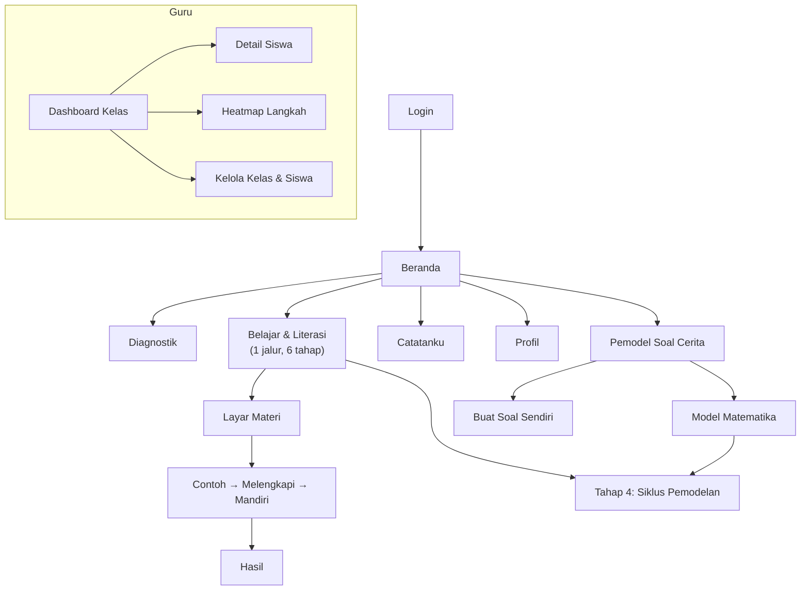

# 06 — UI/UX Guidelines

| Atribut | Nilai |
|---|---|
| Versi | 1.0 |
| Tanggal | 9 November 2026 |
| Acuan | [04-LEARNING-DESIGN.md](04-LEARNING-DESIGN.md) |

---

## 1. Prinsip Desain

1. **Tenang, bukan ramai.** Latar polos, tanpa ornamen, tanpa animasi dekoratif (EL02).
2. **Satu fokus per layar.** Satu konsep, satu aksi utama (tombol utama tunggal).
3. **Siswa mengendalikan tempo.** Tombol Lanjut/Kembali selalu terlihat; tanpa auto-advance (EL04).
4. **Instruksi dekat objek.** Instruksi berada tepat di atas rumus/grafik/input yang dirujuk (split-attention).
5. **Warna bermakna.** Warna dipakai untuk menandai variabel dan metode, bukan untuk hiasan.
6. **Mobile-first.** Dirancang untuk layar 360 × 640 px, kemudian diperluas ke tablet/desktop.

## 2. Design Tokens

### 2.1 Warna

| Token | Hex (terang) | Hex (gelap) | Penggunaan |
|---|---|---|---|
| `--bg` | `#FAFAF7` | `#121417` | Latar |
| `--surface` | `#FFFFFF` | `#1C1F24` | Kartu |
| `--text` | `#1F2328` | `#E8EAED` | Teks utama |
| `--text-muted` | `#5B6470` | `#A0A7B1` | Teks sekunder |
| `--primary` | `#2F6FED` | `#6C9BFF` | Tombol utama |
| **`--var-x`** | `#1D63D8` | `#6FA3FF` | **Variabel x** (biru) |
| **`--var-y`** | `#C2570C` | `#FFA05C` | **Variabel y** (oranye) |
| `--success` | `#1E7F4F` | `#4CC38A` | Jawaban benar |
| `--error` | `#B42318` | `#FF7A70` | Jawaban salah |
| `--hint` | `#7A5AF8` | `#A794FF` | Petunjuk |
| `--method-graph` | `#1E7F4F` | | Kartu metode Grafik |
| `--method-subst` | `#6941C6` | | Kartu metode Substitusi |
| `--method-elim` | `#C11574` | | Kartu metode Eliminasi |
| `--method-mixed` | `#0E7490` | | Kartu metode Campuran |

Semua pasangan teks/latar ≥ 4.5:1 (WCAG AA). Variabel **tidak hanya dibedakan warna**: x dan y juga diberi bentuk chip berbeda (x = sudut bulat, y = sudut persegi) untuk siswa buta warna.

### 2.2 Tipografi

| Token | Ukuran | Penggunaan |
|---|---|---|
| `display` | 24/32 px, 700 | Judul modul |
| `title` | 20/28 px, 600 | Judul layar |
| `body` | 16/24 px, 400 | Instruksi & materi (minimum 16 px) |
| `math` | 20 px (KaTeX) | Rumus |
| `caption` | 14/20 px | Keterangan |

Font: **Inter** atau **Plus Jakarta Sans** (fallback `system-ui`). Mode "Teks besar" menaikkan semua ukuran 125%.

### 2.3 Spasi & Bentuk

- Grid 4 px; padding layar 16 px; jarak antar-blok 16–24 px.
- Radius: kartu 12 px, tombol 10 px.
- Target sentuh minimal 44 × 44 px; tombol utama tinggi 48 px, lebar penuh di mobile.

## 3. Komponen Inti

| Komponen | Deskripsi |
|---|---|
| `MathText` | Render KaTeX; otomatis mewarnai `x`/`y` dengan token variabel |
| `VarChip` | Label makna variabel, mis. **x** = harga 1 buku |
| `StepCard` | Satu langkah solver: instruksi, input, tombol Cek, area umpan balik, tombol Petunjuk |
| `HintButton` | Membuka petunjuk bertingkat (1 → 2 → 3) |
| `MathKeypad` | Keyboard matematika di layar (0–9, x, y, +, −, =, /, ( ), ⌫) |
| `MethodCard` | Kartu metode dengan warna identitas & langkah bernomor |
| `GraphPanel` | Bidang Kartesius (Mafs) dengan tabel x–y dan sorotan titik potong |
| `ProgressDots` | Indikator posisi layar ("3 / 7") |
| `FeedbackBanner` | Umpan balik benar/salah ≤ 15 kata, ikon + warna + teks |
| `NoteDrawer` | Laci catatan pribadi dari bawah layar |
| `StoryPanel` | Cerita soal yang dapat diciutkan, selalu di atas tahap pemodelan |
| `StoryHighlighter` | Ketuk frasa untuk menandai diketahui / ditanya / tidak diperlukan |
| `VariablePicker` | Memilih makna & satuan x dan y |
| `EquationBuilder` | Menyusun persamaan dari kepingan (angka, x, y, operator) |
| `ModelingStepper` | Indikator 7 tahap siklus pemodelan (ikon + nama pendek) |
| `ModelCard` | Hasil pemodel AI: variabel, persamaan + kalimat sumber, label "dibuat otomatis & sudah diperiksa", 👍/👎 |
| `ModelerInput` | Kolom soal cerita dengan penghitung karakter, peringatan data pribadi, sisa kuota |
| `SymbolPad` | Tombol simbol & struktur matematika (pecahan, pangkat, indeks, akar, titik) yang menyisipkan teks di posisi kursor |
| `EquationDialog` | Editor persamaan: templat, bilah simbol, pratinjau langsung, pilihan "di baris sendiri", ubah/hapus |
| `MathRender` / `NoteBody` | Menampilkan persamaan catatan (`$…$`, `$$…$$`): pecahan bersusun, pangkat, akar, sistem berkurung kurawal |

## 4. Peta Navigasi



Navigasi bawah siswa (mobile): **Beranda · Belajar · Pemodel · Catatanku** (maks. 4 item; Profil di pojok kanan atas). Tab "Belajar" membuka halaman **Belajar & Literasi**: satu jalur berisi seluruh modul dalam 6 tahap (Prasyarat → Konsep Dasar → Metode → Pemodelan Soal Cerita → Literasi Lanjut → Bank Soal), didefinisikan di `content/path.json`. Setiap modul diberi peran *Inti*, *Pendalaman*, *Ringkasan*, atau *Bank soal*. Hanya tahap yang sedang dikerjakan yang terbuka (mengurangi beban kognitif); tahap lain dapat dibuka dengan sekali ketuk. Alamat lama `/literasi` diarahkan ke tahap Pemodelan. Tab "Pemodel" disembunyikan bila guru menonaktifkan AI; mode Latih Pemodelan tetap dapat diakses dari tahap Pemodelan.

Wireframe layar Model Matematika: [14-WORD-PROBLEM-MODELER.md §3.2](14-WORD-PROBLEM-MODELER.md#32-tampilan-model-layar-model-matematika).

### Warna penanda pemodelan

| Penanda | Warna | Bentuk tambahan (non-warna) |
|---|---|---|
| Diketahui | Hijau muda | Garis bawah tebal |
| Ditanya | Ungu muda | Ikon ❓ |
| Tidak diperlukan | Abu-abu | Dicoret |

## 5. Wireframe (mobile 360 px)

### 5.1 Beranda Siswa

```
┌────────────────────────────┐
│ Hai, Nadia 👋               │
│                            │
│ ┌────────────────────────┐ │
│ │ Lanjutkan belajar      │ │
│ │ Metode Substitusi  3/7 │ │
│ │ [ Lanjut  → ]          │ │
│ └────────────────────────┘ │
│                            │
│ Progresmu                  │
│ ● Prasyarat     ✓ selesai  │
│ ● Grafik        ✓ 85       │
│ ● Substitusi    … berjalan │
│ ○ Eliminasi                │
│                            │
├────────────────────────────┤
│ Beranda Belajar Catatan Aku│
└────────────────────────────┘
```

### 5.2 Layar Materi (1 konsep)

```
┌────────────────────────────┐
│ ← Metode Substitusi   3/7  │
│ ━━━━━━━━━━━━──────────────  │
│                            │
│ Substitusi artinya         │
│ MEMASUKKAN.                │
│                            │
│      y = 7 − 2x            │
│          ↓ masukkan ke     │
│   3x + (y) = 10            │
│                            │
│ ▸ Ingat kembali:           │
│   memindahkan suku         │
│                            │
│               📝 Catat      │
│ [ ← Kembali ] [ Lanjut → ] │
└────────────────────────────┘
```

### 5.3 Solver Terpandu (soal cerita)

```
┌────────────────────────────┐
│ ← Soal 2 dari 3   Mandiri  │
│ [x = harga 1 buku]         │
│ [y = harga 1 pensil]       │
│                            │
│ (1) 2x + y = 9000          │
│ (2) x + 3y = 7000          │
│ Metode: 🔁 Substitusi ▾     │
│                            │
│ ✓ Langkah 1  y = 9000 − 2x │
│ ┌────────────────────────┐ │
│ │ Langkah 2              │ │
│ │ Masukkan y ke (2).     │ │
│ │ ┌────────────────────┐ │ │
│ │ │ x + 3(9000−2x)=7000│ │ │
│ │ └────────────────────┘ │ │
│ │ ✗ Kalikan 3 ke semua   │ │
│ │   suku dalam kurung.   │ │
│ │ [💡 Petunjuk] [ Cek ]  │ │
│ └────────────────────────┘ │
│ ▸ Grafik bantu  ▸ Kartu    │
│   metode                   │
├────────────────────────────┤
│ 7 8 9 x y ( )  ⌫           │
│ 4 5 6 + − =  /             │
│ 1 2 3 0 .        [Cek]     │
└────────────────────────────┘
```

### 5.4 Grafik Interaktif

```
┌────────────────────────────┐
│ ← Metode Grafik      4/6   │
│ Geser titik ● ke tempat     │
│ kedua garis berpotongan.   │
│        y                   │
│        │   ╲   ╱           │
│        │    ╲ ╱            │
│        │     ●  (?, ?)     │
│        │    ╱ ╲            │
│   ─────┼───────────── x    │
│        │                   │
│ ┌──────┬────┬────┐         │
│ │ x    │ 0  │ 2  │ (1) ━━  │
│ │ y    │ 4  │ 2  │         │
│ └──────┴────┴────┘         │
│          [ Cek titik ]     │
└────────────────────────────┘
```

### 5.5 Dashboard Guru (desktop)

```
┌──────────────────────────────────────────────────────────┐
│ LangkahKu Guru   Kelas: 8A ▾                [Ekspor CSV] │
├──────────┬──────────┬──────────┬──────────────────────────┤
│ Aktif 7h │ Selesai  │ Skor rata│ Prasyarat terlemah       │
│  28/32   │  64%     │  72      │ Bilangan bulat negatif   │
├──────────┴──────────┴──────────┴──────────────────────────┤
│ Heatmap langkah tersulit                                  │
│            L1   L2   L3   L4                              │
│ Subst-A    ░░   ▓▓   ░░   ░░                              │
│ Elim-B     ░░   ██   ▓▓   ░░     █ = sering salah         │
│ Cerita     ██   ▓▓   ░░   ▓▓                              │
├───────────────────────────────────────────────────────────┤
│ Siswa          Diagnostik  Grafik  Subst  Elim  Terakhir  │
│ Nadia            7/10       85     60     –     hari ini  │
│ ...                                                       │
└───────────────────────────────────────────────────────────┘
```

## 6. Pola Interaksi

| Situasi | Perilaku |
|---|---|
| Jawaban benar | Banner hijau "Benar!" + langkah terkunci dengan ✓, fokus pindah ke langkah berikutnya. Tanpa konfeti/suara. |
| Jawaban salah | Banner merah muda dengan umpan balik spesifik; input tidak dihapus agar siswa dapat memperbaiki. |
| 3× salah di langkah yang sama | Petunjuk level berikutnya ditawarkan secara otomatis (tidak dipaksa). |
| Kembali ke materi | Posisi & isian tersimpan. |
| Offline | Bar kecil "Mode offline — jawabanmu akan dikirim nanti". |
| Memuat | Skeleton, bukan spinner layar penuh. |

## 7. Penulisan UI (UX Writing)

- Sapaan **"kamu"**, kalimat aktif, positif.
- Tombol berupa kata kerja: "Cek", "Lanjut", "Coba soal lain".
- Hindari kata yang menghakimi ("Salah besar!", "Kamu gagal"). Gunakan "Belum tepat", "Hampir!".
- Angka & rumus memakai tanda minus asli (−) dan spasi di sekitar operator.

## 8. Aksesibilitas (WCAG 2.1 AA)

- Kontras ≥ 4.5:1 teks normal, ≥ 3:1 elemen grafis.
- Semua rumus KaTeX memiliki `aria-label` bacaan (mis. "dua x tambah y sama dengan tujuh").
- Grafik menyediakan alternatif tabel x–y yang dapat dibaca pembaca layar.
- Fokus keyboard terlihat; urutan tab logis.
- Tidak ada informasi yang hanya disampaikan lewat warna.
- Dukungan "Teks besar" dan mode gelap (FR-19).

## 9. Responsif

| Breakpoint | Tata letak |
|---|---|
| < 640 px | Satu kolom, navigasi bawah, keypad di bawah |
| 640–1024 px | Satu kolom lebar maks. 640 px, grafik di samping soal bila muat |
| > 1024 px | Siswa: konten di tengah maks. 720 px. Guru: sidebar + tabel lebar |
