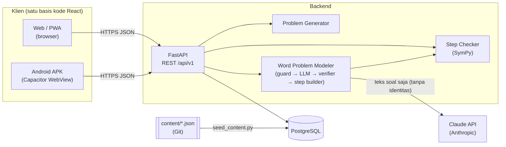
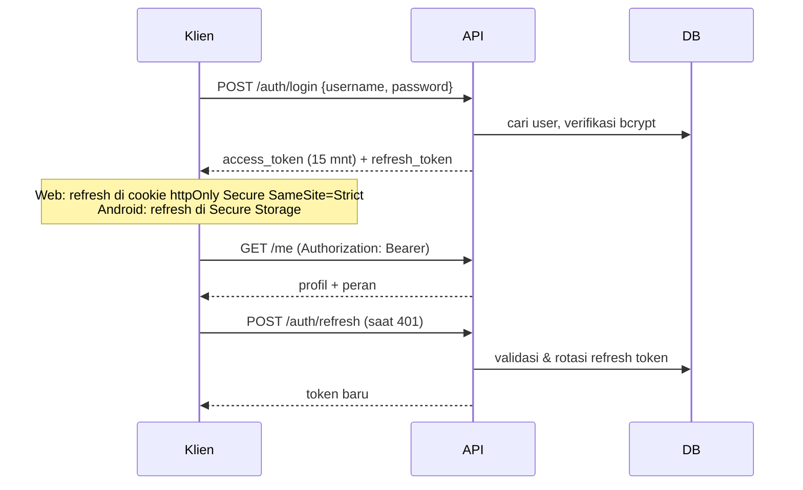
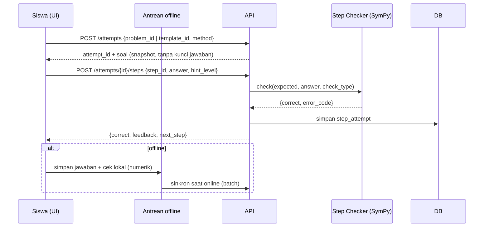
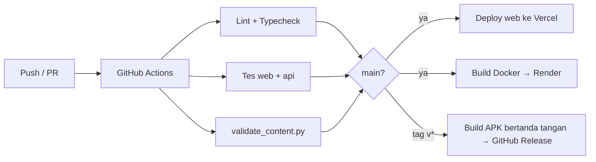

# 07 — Architecture

| Atribut | Nilai |
|---|---|
| Versi | 1.0 |
| Tanggal | 9 November 2026 |
| Acuan | [02-PRD.md](02-PRD.md) |

---

## 1. Gambaran Sistem



**Pola:** SPA (React) + REST API (FastAPI) + PostgreSQL. Android adalah build React yang sama dibungkus Capacitor, sehingga **satu basis kode** untuk web dan Android.

## 2. Teknologi & Alasan

### 2.1 Frontend (`apps/web`)

| Teknologi | Versi | Alasan |
|---|---|---|
| React | 18.x | Ekosistem luas, komponen reusable |
| Vite | 5.x | Build cepat, dukungan PWA plugin |
| TypeScript | 5.x (strict) | Mengurangi bug, kontrak data jelas |
| Tailwind CSS | 3.x | Design token via CSS variables, bundle kecil |
| React Router | 6.x | Routing SPA |
| TanStack Query | 5.x | Cache data server, retry, dukungan offline |
| Zustand | 4.x | State UI ringan (solver, keypad) |
| KaTeX | 0.16.x | Render rumus cepat (lebih ringan dari MathJax) |
| Mafs | 0.19.x | Grafik Kartesius interaktif berbasis React/SVG, mendukung sentuh |
| vite-plugin-pwa (Workbox) | 0.20.x | Service worker, cache offline |
| Dexie (IndexedDB) | 4.x | Antrean jawaban offline |
| Capacitor | 6.x | Bungkus Android; plugin Preferences/Secure Storage, Network, App |
| Vitest, RTL, Playwright | — | Pengujian |

### 2.2 Backend (`apps/api`)

| Teknologi | Versi | Alasan |
|---|---|---|
| Python | 3.12 | Sesuai pilihan; SymPy unggul untuk aljabar simbolik |
| FastAPI | 0.11x | Async, validasi otomatis, OpenAPI/Swagger bawaan |
| Pydantic | 2.x | Skema request/response |
| SQLAlchemy | 2.x (async) + asyncpg | ORM modern |
| Alembic | 1.x | Migrasi skema |
| SymPy | 1.13 | Cek kesetaraan persamaan/ekspresi & klasifikasi kesalahan |
| python-jose / PyJWT | — | JWT |
| passlib[bcrypt] | — | Hash password |
| slowapi | — | Rate limiting login & pemodel |
| anthropic (Python SDK) | terbaru | Pemanggilan Claude API untuk pemodel soal cerita (`messages.parse` + Pydantic, model `claude-opus-5-5`) |
| rapidfuzz | — | Pencocokan kalimat sumber (verifikasi V4) |
| pytest, httpx | — | Pengujian |

### 2.3 Infrastruktur

| Komponen | Pilihan MVP | Alternatif |
|---|---|---|
| Hosting frontend | Vercel / Netlify (HTTPS, CDN) | Cloudflare Pages |
| Hosting API | Render / Railway (Docker) | VPS + Docker Compose |
| Database | Neon / Supabase Postgres (region Singapura) | Postgres di VPS |
| CI/CD | GitHub Actions | — |
| Monitoring error | Sentry (self-host atau dengan PII dimatikan) | Log terstruktur saja |
| Distribusi Android | APK langsung (MVP) → Google Play (internal testing) | — |

## 3. Struktur Monorepo

```
/
├── apps/
│   ├── web/
│   │   ├── src/
│   │   │   ├── features/
│   │   │   │   ├── auth/  diagnostic/  lessons/  solver/
│   │   │   │   ├── graph/ practice/   notes/    progress/  teacher/
│   │   │   ├── components/ui/      # MathText, VarChip, StepCard, MathKeypad, ...
│   │   │   ├── lib/                # apiClient.ts, offlineQueue.ts, mathFormat.ts
│   │   │   ├── locales/id.json
│   │   │   ├── routes/
│   │   │   └── styles/tokens.css
│   │   ├── android/                # dihasilkan Capacitor
│   │   ├── capacitor.config.ts
│   │   └── vite.config.ts
│   └── api/
│       ├── app/
│       │   ├── main.py
│       │   ├── core/        # config.py, security.py, db.py, deps.py
│       │   ├── models/      # SQLAlchemy
│       │   ├── schemas/     # Pydantic
│       │   ├── routers/     # auth, classes, content, attempts, diagnostic, notes, teacher, admin
│       │   └── services/    # step_checker.py, error_classifier.py, problem_generator.py, scoring.py, analytics.py, literacy.py
│       │       └── modeler/ # guard.py, llm_client.py, prompt.py, schema.py, verifier.py, step_builder.py, number_parser.py
│       ├── alembic/
│       ├── tests/
│       └── Dockerfile
├── content/                 # lihat 05-CONTENT-SPEC.md
├── scripts/                 # validate_content.py, seed_content.py
├── docs/
└── .github/workflows/       # ci.yml (lint, test, validate content, build)
```

## 4. Alur Penting

### 4.1 Autentikasi



### 4.2 Pengerjaan Langkah Soal



**Kunci jawaban tidak pernah dikirim ke klien** untuk soal mandiri; kecuali untuk mode offline, di mana klien menerima *hash* jawaban dan titik uji numerik (lihat §5.2).

## 5. Komponen Kunci

### 5.1 Step Checker (`services/step_checker.py`)

| `check` | Logika |
|---|---|
| `equation_equivalent` | Parse kedua persamaan → `lhs - rhs`; setara jika `simplify(a - k·b) == 0` untuk suatu konstanta k ≠ 0 (menangani bentuk yang dikalikan konstanta) |
| `expression_equivalent` | `simplify(a - b) == 0` |
| `value` | Bandingkan nilai numerik (toleransi 1e-9; pecahan rasional exact) |
| `point` | Pasangan (x, y) sama |
| `choice` / `define_variables` | Cocokkan ID opsi |
| `interpret` | Pilihan kalimat atau nilai + satuan |

Parsing memakai `sympy.parsing.sympy_parser` dengan `implicit_multiplication` dan **whitelist** simbol (`x`, `y`, angka, operator) — tidak pernah `eval`. Batas panjang input 100 karakter dan timeout 1 detik per pemeriksaan.

`error_classifier.py` menguji hipotesis kesalahan umum (salah tanda, tukar variabel, perkalian parsial) dan mengembalikan `error_code` sesuai [04-LEARNING-DESIGN.md §8](04-LEARNING-DESIGN.md#8-umpan-balik-per-jenis-kesalahan).

### 5.2 Validasi Offline

Untuk soal yang di-cache offline, klien menerima titik uji `{x, y}` acak dan hash SHA-256 dari jawaban ter-normalisasi. Klien memeriksa kesetaraan secara numerik (evaluasi kedua ruas di beberapa titik dengan parser ekspresi kecil, mis. `mathjs`). Saat online, server memvalidasi ulang dan skor resmi berasal dari server.

### 5.3 Problem Generator (`services/problem_generator.py`)

Lihat [05-CONTENT-SPEC.md §5](05-CONTENT-SPEC.md#5-skema-template-generator-gl05). Deterministik berdasarkan `seed`.

### 5.4 Analitik Guru (`services/analytics.py`)

Agregasi dari `step_attempts`: tingkat kesalahan per (pattern, step_id), distribusi `hint_level`, `error_code` terbanyak. Dihitung dengan query SQL teragregasi; MVP tanpa *materialized view* (≤ 40 siswa/kelas), dapat ditambahkan bila lambat.

### 5.5 Word Problem Modeler (`services/modeler/`)

Pipeline: **guard** (panjang, kuota, PII, cache hash) → **LLM client** (Claude API, structured output) → **verifier** (SymPy: linear, jejak angka, kalimat sumber, kewajaran) → **step builder** (langkah siklus pemodelan + langkah metode). AI hanya menghasilkan model; penyelesaian dihitung SymPy. Spesifikasi lengkap: [14-WORD-PROBLEM-MODELER.md](14-WORD-PROBLEM-MODELER.md).

- Pemanggilan Claude bersifat sinkron di dalam request (p95 ≤ 12 detik) dengan timeout 30 detik. Bila beban tinggi, dapat dipindah ke antrean latar (ARQ/Redis) dan klien melakukan polling, tanpa mengubah kontrak API.
- Kunci API hanya ada di backend (`ANTHROPIC_API_KEY`); klien tidak pernah memanggil Claude secara langsung.
- Setiap pemanggilan mencatat `model`, `PROMPT_VERSION`, token input/output, dan latensi ke `modeler_submissions` untuk pemantauan biaya.

### 5.6 Literasi (`services/literacy.py`)

Menghitung profil literasi (merumuskan, menerapkan, menafsirkan, penalaran) dari `step_attempts` yang digabung dengan `modeling_stage` dan `literacy` metadata soal ([13 §8](13-MATH-LITERACY.md#8-penilaian-literasi)).

## 6. Strategi Offline (PWA & Android)

| Sumber daya | Strategi Workbox |
|---|---|
| App shell (JS/CSS/font) | Precache |
| `GET /modules`, `/lessons/*` | Stale-while-revalidate |
| `GET /problems/*` | Network-first, fallback cache |
| `POST /attempts/*` | Antrean Dexie → sinkron saat `online` (plugin Network Capacitor di Android) |
| `POST /modeler/*` | Tidak di-cache; tombol dinonaktifkan saat offline |

## 7. Build & Deploy



Lingkungan: `development` (lokal), `staging` (preview per PR), `production`.

## 8. Keputusan Arsitektur (ADR ringkas)

| ADR | Keputusan | Alasan | Konsekuensi |
|---|---|---|---|
| 001 | React + Capacitor untuk web & Android | Satu basis kode, sesuai pilihan React + Vite | Performa grafik bergantung WebView; diuji di HP low-end |
| 002 | FastAPI (Python) sebagai backend | SymPy untuk validasi aljabar; produktivitas tinggi | Validasi butuh server → solusi offline numerik (§5.2) |
| 003 | Konten di JSON dalam Git, bukan CMS | Versi terkontrol, dapat divalidasi otomatis, sederhana | Perubahan konten butuh deploy; CMS dapat ditambahkan nanti |
| 004 | Mafs untuk grafik | Native React, interaktif, ringan | Fitur terbatas dibanding GeoGebra, tetapi cukup untuk garis & titik |
| 005 | JWT access pendek + refresh rotasi | Cocok untuk SPA & app mobile | Perlu tabel `refresh_tokens` |
| 006 | Langkah soal disimpan sebagai JSONB di `problems` | Struktur langkah bervariasi per metode | Query analitik memakai `step_id` string |
| 007 | Tanpa analitik pihak ketiga | Pengguna anak, privasi | Analitik produk dari data internal saja |
| 008 | Claude API (`claude-opus-5-5`) untuk menerjemahkan soal cerita → model terstruktur; SymPy untuk verifikasi & penyelesaian | Pemahaman bahasa Indonesia alami sulit dicapai dengan aturan; SymPy menjamin kebenaran matematis | Butuh internet, biaya per pemanggilan, kebijakan privasi; dimitigasi dengan verifier, kuota, cache, fitur default nonaktif |
| 009 | AI tidak pernah menghasilkan teks yang langsung tampil ke siswa (kecuali kutipan dari input yang sudah diverifikasi) | Keamanan konten & aturan bahasa CLT | Semua teks UI berasal dari templat |
