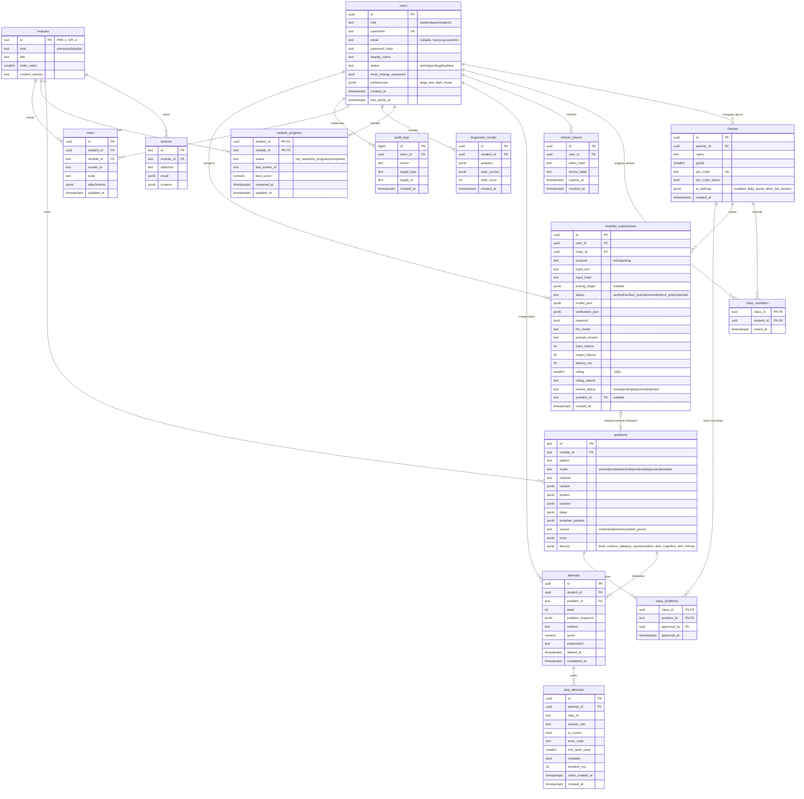

# 08 — Data Model

| Atribut | Nilai |
|---|---|
| Versi | 1.0 |
| Tanggal | 9 November 2026 |
| DBMS | PostgreSQL 16 |
| Acuan | [07-ARCHITECTURE.md](07-ARCHITECTURE.md) |

---

## 1. ERD

## 2. Kamus Data Ringkas

### users
| Kolom | Tipe | Constraint | Keterangan |
|---|---|---|---|
| id | uuid | PK, default `gen_random_uuid()` | |
| role | text | NOT NULL, CHECK in (`student`,`teacher`,`admin`) | |
| username | citext | UNIQUE NOT NULL | 3–30 karakter, `[a-z0-9_.]` |
| email | citext | UNIQUE NULL | Wajib untuk guru/admin; **tidak dikumpulkan dari siswa** |
| password_hash | text | NOT NULL | bcrypt cost 12 |
| display_name | text | NOT NULL | Nama panggilan, maks. 40 karakter |
| status | text | default `active` | Guru baru → `pending` |
| must_change_password | bool | default false | true setelah reset oleh guru |
| preferences | jsonb | default `{}` | `{ "large_text": bool, "dark_mode": bool }` (FR-19) |

### step_attempts (sumber utama analitik)
| Kolom | Keterangan |
|---|---|
| step_id | ID langkah dari `problems.steps[].id` |
| answer_raw | Teks jawaban siswa (maks. 100 karakter) |
| error_code | `SIGN_ERROR`, `ARITH_ERROR`, `VAR_SWAP`, `PARTIAL_MULTIPLY`, `WRONG_METHOD_STEP`, `FORMAT`, `UNKNOWN`, atau NULL bila benar |
| hint_level_used | 0–3, level petunjuk tertinggi yang dibuka sebelum jawaban ini |
| revealed | Siswa menekan "Tampilkan jawaban langkah ini" |
| client_created_at | Waktu di perangkat (untuk sinkronisasi offline) |

### modeler_submissions (pemodel AI)
| Kolom | Keterangan |
|---|---|
| input_text | Teks soal setelah penyamaran PII (maks. 1.000 karakter) |
| input_hash | SHA-256 dari teks ternormalisasi, untuk cache hasil yang sudah terverifikasi |
| model_json | Keluaran `WordProblemModel` dari Claude |
| verification_json | Hasil V1–V7, solusi SymPy, alasan gagal |
| repaired | Apakah perlu satu putaran perbaikan |
| llm_model, prompt_version, input_tokens, output_tokens, latency_ms | Pemantauan kualitas & biaya |
| rating, rating_reason | Umpan balik 👍/👎 siswa |
| review_status, problem_id | Alur persetujuan guru → bank soal kelas |

### classes.ai_settings
`{ "enabled": false, "daily_quota": 10, "allow_full_solution": true }`. Default `enabled: false`.

## 3. Indeks

| Tabel | Indeks | Tujuan |
|---|---|---|
| classes | `UNIQUE(join_code)` | Gabung kelas |
| class_members | `(student_id)` | Kelas milik siswa |
| attempts | `(student_id, problem_id, started_at DESC)` | Riwayat siswa |
| step_attempts | `(attempt_id)` | Detail attempt |
| step_attempts | `(created_at)` | Analitik periode |
| module_progress | `(module_id, status)` | Ringkasan kelas |
| refresh_tokens | `(token_hash)` | Validasi refresh |
| modeler_submissions | `(input_hash) WHERE status IN ('verified','verified_special')` | Cache hasil |
| modeler_submissions | `(user_id, created_at)` | Hitung kuota harian |
| modeler_submissions | `(class_id, review_status)` | Antrean tinjauan guru |
| problems | `((literacy->>'level'), (literacy->>'context_category'))` | Filter bank soal literasi |

## 4. Aturan Integritas & Retensi

- Hapus siswa → `ON DELETE CASCADE` ke `class_members`, `attempts`, `step_attempts`, `module_progress`, `diagnostic_results`, `notes`, `refresh_tokens`.
- Hapus guru → kelas dipindahkan ke admin atau dihapus setelah konfirmasi (tidak otomatis).
- Konten (`modules`, `lessons`, `problems`) di-*upsert* oleh `seed_content.py`; soal yang sudah pernah dikerjakan tidak dihapus, hanya ditandai `content_version` lama. `attempts.problem_snapshot` menjaga riwayat tetap konsisten.
- `modeler_submissions.input_text` siswa dihapus setelah 180 hari (metadata token & status disimpan untuk statistik), kecuali sudah disetujui guru menjadi soal.
- Retensi: data siswa yang tidak aktif > 2 tahun dianonimkan (lihat [10-SECURITY-PRIVACY.md](10-SECURITY-PRIVACY.md)).

## 5. Migrasi

- Semua perubahan skema melalui Alembic (`alembic revision --autogenerate`), ditinjau manual sebelum commit.
- Ekstensi yang diperlukan: `pgcrypto` (UUID), `citext`.
