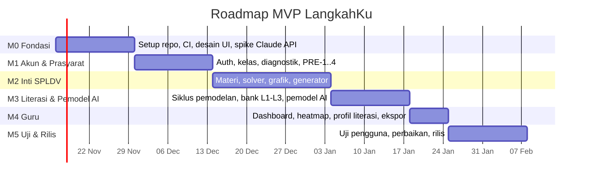

# 12 — Roadmap

| Atribut | Nilai |
|---|---|
| Versi | 1.1 (ditambah literasi & pemodel AI) |
| Tanggal | 9 November 2026 |
| Durasi MVP | ± 12 minggu (6 sprint × 2 minggu) |
| Tim | 1 pengembang (Riki Agil Saputra) + guru matematika sebagai reviewer konten |

> Tanggal di bawah adalah perkiraan bila pengembangan dimulai **Senin, 16 November 2026**. Sesuaikan dengan kalender akademik.

---

## 1. Ringkasan Milestone

| Milestone | Minggu | Perkiraan tanggal | Hasil |
|---|---|---|---|
| **M0 — Fondasi** | 1–2 | 16 – 29 Nov 2026 | Monorepo, CI, design tokens, komponen UI dasar, prototipe Figma, **spike pemodel AI** (prompt awal + 20 soal uji) |
| **M1 — Akun & Prasyarat** | 3–4 | 30 Nov – 13 Des 2026 | Login/daftar, kelas, diagnostik, 4 modul penyegaran |
| **M2 — Inti SPLDV** | 5–7 | 14 Des 2026 – 3 Jan 2027 | 7 modul SPLDV, solver + petunjuk, step checker, grafik interaktif, generator, catatan |
| **M3 — Literasi & Pemodel AI** | 8–9 | 4 – 17 Jan 2027 | Siklus pemodelan 7 tahap, bank soal L1–L3, pemodel AI terverifikasi, buat soal sendiri, set evaluasi |
| **M4 — Dashboard Guru** | 10 | 18 – 24 Jan 2027 | Ringkasan kelas, heatmap, profil literasi, kontrol AI, tinjauan kiriman, ekspor CSV |
| **M5 — Uji & Rilis** | 11–12 | 25 Jan – 7 Feb 2027 | Uji pengguna (termasuk pretes–postes literasi), offline, perbaikan, rilis web + APK v1.0 |

## 2. Rincian Sprint

### Sprint 1 (M0) — Fondasi
- [ ] Inisialisasi monorepo (`apps/web`, `apps/api`, `content/`, `scripts/`)
- [ ] Vite + React + TS + Tailwind + design tokens ([06-UI-UX-GUIDELINES.md](06-UI-UX-GUIDELINES.md))
- [ ] FastAPI + SQLAlchemy + Alembic + Docker Compose Postgres
- [ ] GitHub Actions: lint, typecheck, test
- [ ] Capacitor: build APK "hello world" dan uji di HP nyata
- [ ] Komponen: `MathText`, `VarChip`, `ProgressDots`, `Button`, `Card`
- [ ] Prototipe Figma: Beranda, Materi, Solver, Grafik, Siklus Pemodelan, Model Matematika, Dashboard guru → uji cepat dengan 1–2 siswa
- [ ] JSON Schema konten (termasuk field `literacy` & `modeling_stage`) + `validate_content.py`
- [ ] **Spike pemodel AI:** skrip mandiri `messages.parse` + `WordProblemModel` pada 20 soal → ukur akurasi, latensi, biaya awal

### Sprint 2 (M1) — Akun & Prasyarat
- [ ] US-01 – US-06 (auth, kelas, verifikasi guru)
- [ ] US-07 Diagnostik, US-08 Penyegaran PRE-1..4, US-09 Ingat kembali
- [ ] Konten PRE-1..4 + diagnostik ditulis & direview guru
- [ ] Tes otorisasi (IDOR) dasar
- [ ] Mulai menulis bank soal literasi L1 (konten paralel)

### Sprint 3 (M2a) — Materi & Solver
- [ ] US-10 Materi per layar, US-11/12 Kartu & pilihan metode, US-13 Peta progres
- [ ] `step_checker.py` + `error_classifier.py` + tes SC-01..SC-11
- [ ] US-14 Solver, US-15 Petunjuk bertingkat, `MathKeypad`
- [ ] Konten SPL-1, SPL-2, SPL-4

### Sprint 4 (M2b) — Grafik, Latihan, Soal Cerita
- [ ] US-17/18/19 Grafik interaktif (Mafs)
- [ ] US-20/21 Alur contoh → melengkapi → mandiri + generator
- [ ] US-16 Tentukan variabel (soal cerita)
- [ ] US-22 Catatanku, US-23 Jelaskan dengan kata-katamu
- [ ] Konten SPL-3, SPL-5, SPL-6, SPL-7

### Sprint 5 (M3) — Literasi & Pemodel AI
- [ ] US-30 Siklus pemodelan (`StoryHighlighter`, `VariablePicker`, `EquationBuilder`, `ModelingStepper`)
- [ ] US-31 Bank soal L1–L3 (≥ 30 soal) + format AKM
- [ ] `services/modeler/`: guard, llm_client, prompt, verifier V1–V7, number_parser, step_builder + tes MV-01..MV-12
- [ ] US-33 Pemodel otomatis, US-34 Penyelesaian dari model AI
- [ ] US-36 Buat soal sendiri
- [ ] Set evaluasi 165 kasus → capai target G9; catat `PROMPT_VERSION`

### Sprint 6 (M4 + M5) — Guru, Offline, Uji, Rilis
- [ ] US-24 – US-27 Dashboard guru, heatmap, ekspor
- [ ] US-32 Profil literasi, US-35 Kontrol AI & tinjauan kiriman
- [ ] US-28 Offline & sinkronisasi
- [ ] Uji kinerja, aksesibilitas, keamanan (termasuk prompt injection)
- [ ] **Uji pengguna** 5–10 siswa + guru, pretes–postes literasi ([11-TEST-PLAN.md §6](11-TEST-PLAN.md#6-uji-pengguna-usability--beban-kognitif))
- [ ] Perbaikan prioritas hasil uji
- [ ] Deploy produksi + APK bertanda tangan v1.0 + panduan singkat guru + kebijakan privasi (termasuk pengungkapan AI)

## 3. Pasca-MVP (Backlog)

| Versi | Fitur |
|---|---|
| v1.1 | US-29 Teks besar & mode gelap; ekspor data siswa (JSON); tombol "Laporkan soal" |
| v1.2 | **Foto soal** untuk pemodel AI (Claude vision); mode belajar mandiri tanpa kelas; rilis Google Play |
| v1.3 | Editor konten untuk guru (CMS sederhana); bank soal tambahan; pemodel AI membuat variasi soal literasi untuk guru |
| v2.0 | Materi & pemodelan lain (PLSV, perbandingan, aritmetika sosial, persamaan garis lurus, SPLTV), adaptivitas lanjut, iOS |

## 4. Risiko Jadwal

| Risiko | Probabilitas | Dampak | Mitigasi |
|---|---|---|---|
| Penulisan konten (materi + 30 soal literasi) memakan waktu lebih lama | Tinggi | Tinggi | Mulai konten sejak Sprint 1–2; prioritaskan SPL-3/4/5/7 dan L1–L2 |
| Akurasi pemodel AI belum mencapai target | Sedang | Tinggi | Spike di Sprint 1; perbaiki prompt & few-shot berbasis set evaluasi; status `unverified` tidak ditampilkan sehingga kualitas tetap terjaga |
| Biaya API selama pengembangan & uji | Sedang | Sedang | Mock di tes otomatis; eval set dijalankan manual; batas anggaran |
| Error classifier rumit | Sedang | Sedang | MVP: SIGN_ERROR, VAR_SWAP, FORMAT, MODEL_REVERSED dulu; lainnya `UNKNOWN` |
| Kinerja grafik di WebView HP low-end | Sedang | Sedang | Uji di HP nyata sejak Sprint 1; batasi elemen SVG |
| Libur akhir tahun (Des–Jan) mengurangi akses ke sekolah | Tinggi | Sedang | Jadwalkan uji pengguna akhir Januari–awal Februari; siapkan izin sejak Desember |
| Pengembang tunggal sakit/ujian | Sedang | Tinggi | Buffer: FR Should/Could (FR-24, FR-25, FR-26) dapat ditunda ke v1.1 |

## 5. Definition of Done — Rilis v1.0

- Semua FR prioritas **Must** lolos kriteria penerimaan.
- Kriteria keluar di [11-TEST-PLAN.md §8](11-TEST-PLAN.md#8-kriteria-masuk--keluar) terpenuhi.
- Set evaluasi pemodel AI memenuhi target G9 ([02-PRD.md §3](02-PRD.md#3-tujuan--metrik-keberhasilan)).
- Dokumen di `docs/` diperbarui sesuai implementasi akhir.
- Panduan guru (PDF 2 halaman) dan kebijakan privasi tersedia.
