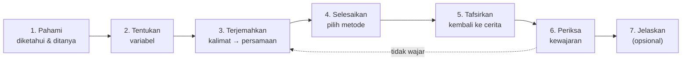

# 13 — Math Literacy: Kerangka Literasi Matematika

| Atribut | Nilai |
|---|---|
| Versi | 1.0 |
| Tanggal | 9 November 2026 |
| Acuan | [02-PRD.md](02-PRD.md) (FR-20 – FR-26), [04-LEARNING-DESIGN.md](04-LEARNING-DESIGN.md), [14-WORD-PROBLEM-MODELER.md](14-WORD-PROBLEM-MODELER.md) |

---

## 1. Latar Belakang

Selain menguasai prosedur SPLDV, aplikasi ini bertujuan **menumbuhkembangkan literasi matematika siswa**, yaitu kemampuan memakai matematika untuk memahami dan menyelesaikan masalah nyata. Wawancara awal (lihat [01-RESEARCH-INSIGHTS.md](01-RESEARCH-INSIGHTS.md)) menunjukkan bahwa kesulitan utama siswa justru terjadi saat **menerjemahkan soal cerita menjadi model** (K01, IL01, IL05). Kesulitan ini merupakan inti literasi matematika.

## 2. Acuan Kerangka

| Kerangka | Unsur yang dipakai |
|---|---|
| **PISA 2022 Mathematics Framework** (OECD) | Penalaran matematis serta tiga proses: **merumuskan** (*formulate*), **menerapkan** (*employ*), dan **menafsirkan & mengevaluasi** (*interpret & evaluate*). Konteks: personal, pekerjaan, sosial, ilmiah |
| **AKM Numerasi** (Asesmen Nasional, Kemendikbudristek) | Domain konten **Aljabar**; konteks **personal, sosial budaya, saintifik**; level kognitif **pemahaman, penerapan, penalaran**; bentuk soal pilihan ganda, pilihan ganda kompleks, menjodohkan, isian, uraian |
| **Kurikulum Merdeka Fase D** | Elemen Aljabar: menyelesaikan SPLDV melalui beberapa cara untuk menyelesaikan masalah |

Definisi kerja: **literasi matematika** adalah kemampuan siswa untuk *memahami situasi, merumuskannya menjadi model matematika, menyelesaikan model, lalu menafsirkan dan menilai kewajaran hasilnya dalam konteks semula.*

## 3. Siklus Pemodelan di LangkahKu

Siklus pemodelan diturunkan dari proses PISA. Setiap tahap tampil sebagai **satu langkah di satu layar** agar tetap sesuai prinsip beban kognitif (CLT).

| Tahap | Proses PISA | Aktivitas siswa di aplikasi | Bantuan (scaffold) |
|---|---|---|---|
| 1. Pahami | Merumuskan | Mengetuk bagian cerita yang merupakan **informasi diketahui** dan **yang ditanyakan**; menandai informasi yang tidak diperlukan (level L2+) | Sorotan warna; petunjuk "Cari angka beserta satuannya" |
| 2. Tentukan variabel | Merumuskan | Memilih atau menulis makna x dan y beserta satuannya | Opsi pilihan (L1) → ketik bebas (L3) |
| 3. Terjemahkan | Merumuskan | Mengubah setiap kalimat informasi menjadi **kalimat matematika**, lalu menjadi persamaan | Penyusun persamaan berbasis kepingan (*tile*); contoh frasa → simbol |
| 4. Selesaikan | Menerapkan | Mengerjakan SPLDV dengan solver terpandu (FR-07) | Kartu metode, petunjuk 3 level, grafik bantu |
| 5. Tafsirkan | Menafsirkan | Menuliskan jawaban dalam kalimat dan satuan konteks | Templat kalimat "Jadi, ... adalah ..." |
| 6. Periksa kewajaran | Mengevaluasi | Mensubstitusi jawaban ke cerita dan menilai kewajarannya (positif, bulat, masuk akal) | Pertanyaan pemicu: "Mungkinkah harga pensil negatif?" |
| 7. Jelaskan | Penalaran | "Jelaskan dengan kata-katamu" (FR-13) | Opsional |

**Fading pada siklus:** pada soal pertama, tahap 1–3 dicontohkan. Pada soal berikutnya, contoh dikurangi bertahap mulai dari tahap 1 hingga siswa mengerjakan seluruh siklus sendiri. Prinsip ini sama dengan fading pada [04-LEARNING-DESIGN.md §2](04-LEARNING-DESIGN.md#2-prinsip-desain--penerapannya).

### 3.1 Dari Kalimat ke Matematika (bukan sekadar kata kunci)

Strategi "kata kunci" (misalnya "lebih" selalu berarti +) sering menyesatkan siswa. Karena itu aplikasi menekankan **makna kalimat**, dan setiap contoh frasa disertai contoh yang menjebak.

| Frasa | Kalimat matematika | Hati-hati |
|---|---|---|
| "harga 2 buku dan 3 pensil Rp19.000" | 2x + 3y = 19000 | — |
| "umur ayah 3 kali umur anak" | a = 3n | Bukan 3a = n |
| "selisih umur mereka 24 tahun" | a − n = 24 | Yang lebih besar dikurangi yang lebih kecil |
| "uang Ani Rp5.000 lebih banyak dari uang Budi" | a = b + 5000 | "Lebih banyak dari" ≠ selalu menjumlah di ruas kiri |
| "jumlah kaki ayam dan kambing 100" | 2x + 4y = 100 | Kaki ayam = 2 × banyak ayam |

### 3.2 Materi Lengkap sebagai Fondasi

Sebelum soal L1–L3, halaman Literasi menyediakan **Materi Lengkap SPLDV** (modul MAT-1 s.d. MAT-4): definisi PLDV/SPLDV, variabel, koefisien, konstanta, langkah setiap metode, dan pengubahan soal cerita menjadi model matematika beserta contoh dari buku ajar. Rincian: [05-CONTENT-SPEC.md §1.2b](05-CONTENT-SPEC.md#12b-materi-lengkap-spldv-mat-level-materi-tampil-paling-atas-di-halaman-literasi).

## 4. Tingkat Literasi Soal (L1–L3)

Soal literasi dibagi menjadi tiga tingkat agar beban intrinsik naik secara bertahap.

| Level | Ciri soal | Level kognitif AKM | Contoh |
|---|---|---|---|
| **L1 — Langsung** | Konteks sederhana, semua informasi berupa teks, tidak ada informasi berlebih, langsung meminta nilai x dan y | Pemahaman | "Harga 2 buku dan 1 pensil Rp9.000. Harga 1 buku dan 3 pensil Rp7.000. Berapa harga 1 buku?" |
| **L2 — Representasi** | Informasi tersaji dalam tabel, struk belanja, gambar, atau grafik; ada informasi yang tidak diperlukan; jawaban perlu satu langkah lanjutan | Penerapan | Struk belanja dua hari di koperasi sekolah → "Berapa yang dibayar Nadia untuk 4 buku dan 2 pensil?" |
| **L3 — Penalaran** | Situasi keputusan atau perbandingan, evaluasi klaim, kasus tanpa penyelesaian tunggal, jawaban berupa argumen | Penalaran | "Paket A: Rp50.000 + Rp2.000/GB. Paket B: Rp30.000 + Rp4.000/GB. Kapan paket A lebih hemat? Benarkah klaim Dani bahwa paket B selalu lebih murah?" |

Siswa membuka L2 setelah menguasai L1 (3 soal ≥ 75). L3 tersedia setelah L2. Guru dapat membuka semua level secara manual.

## 5. Bank Konteks

Konteks dipilih yang **dekat dengan kehidupan siswa SMP di Indonesia** (personal, sosial budaya, saintifik).

| Kategori | Contoh konteks SPLDV |
|---|---|
| Personal | Jajan di kantin, paket kuota internet, tiket wahana, tabungan, ongkos ojek daring |
| Sosial budaya | Belanja di pasar tradisional, koperasi sekolah, hajatan/arisan, parkir motor dan mobil, iuran kelas, tiket masuk museum (dewasa/anak) |
| Pekerjaan | Upah tukang harian, ongkos kirim, produksi kue untuk dijual, sewa kursi dan meja |
| Saintifik | Kaki hewan ternak, campuran dua jenis beras/kopi, perjalanan dengan dua kecepatan, umur |
| Geometri | Keliling dan selisih panjang–lebar persegi panjang, sudut berpelurus |

Setiap konteks memiliki variasi angka (generator) agar sesuai prinsip GL05: pola sama, angka berbeda.

## 6. Bentuk Soal (format AKM)

| Format | Penerapan di aplikasi | Contoh penggunaan |
|---|---|---|
| Pilihan ganda | `choice` | Memilih model yang tepat dari 4 pilihan SPLDV |
| Pilihan ganda kompleks | `multi_choice` | Mencentang semua pernyataan yang benar tentang hasil |
| Menjodohkan | `match` | Menjodohkan kalimat cerita dengan persamaannya |
| Isian singkat | `value` / `equation_equivalent` | Menulis persamaan atau nilai |
| Uraian | `explanation` | Menjelaskan alasan di soal L3 (dinilai guru atau rubrik sederhana) |
| Benar/salah dengan alasan | `claim_evaluation` | Menilai klaim tokoh dalam cerita (L3) |

Format baru ini ditambahkan ke daftar `steps[].check` di [05-CONTENT-SPEC.md](05-CONTENT-SPEC.md#4-skema-problem-soal-terpandu).

## 7. Fitur Literasi

| Fitur | FR | Deskripsi singkat |
|---|---|---|
| **Latih Pemodelan** | FR-20 | Siklus 7 tahap (§3) untuk soal cerita dari bank soal |
| **Bank Soal Literasi** | FR-21 | Soal L1–L3 dengan beragam konteks, representasi, dan format AKM |
| **Pemodel Otomatis (AI)** | FR-22, FR-23 | Siswa atau guru mengetik soal cerita apa pun. Aplikasi mengubahnya menjadi model SPLDV yang sudah diverifikasi, lalu siswa menyelesaikannya secara terpandu. Lihat [14-WORD-PROBLEM-MODELER.md](14-WORD-PROBLEM-MODELER.md) |
| **Kontrol Guru atas AI** | FR-24 | Aktif/nonaktif per kelas, kuota harian, tinjau dan simpan ke bank soal kelas |
| **Buat Soal Sendiri** (*problem posing*) | FR-25 | Siswa menulis cerita untuk SPLDV yang diberikan. Pemodel AI mengubah cerita itu kembali menjadi model, lalu aplikasi memeriksa apakah sama dengan sistem sasaran |
| **Profil Literasi** | FR-26 | Dashboard guru menampilkan keberhasilan per tahap siklus (memahami, merumuskan, menerapkan, menafsirkan) dan per konteks |

## 8. Penilaian Literasi

Setiap langkah soal diberi label tahap siklus (`modeling_stage`). Profil literasi siswa dihitung dari `step_attempts`:

| Indikator | Sumber data | Makna |
|---|---|---|
| Merumuskan | Langkah tahap 1–3 | Kemampuan memahami cerita dan membuat model |
| Menerapkan | Langkah tahap 4 | Kemampuan prosedural menyelesaikan SPLDV |
| Menafsirkan & mengevaluasi | Langkah tahap 5–6 | Kemampuan mengaitkan hasil dengan konteks |
| Penalaran | Soal L3, uraian | Kemampuan berargumen |
| Sebaran konteks | `literacy.context_category` | Konteks yang masih sulit |

Skor tiap indikator memakai aturan skoring langkah yang sama ([04-LEARNING-DESIGN.md §9](04-LEARNING-DESIGN.md#9-skoring--penguasaan)). Dengan profil ini guru dapat membedakan siswa yang **lemah merumuskan model** dari siswa yang **lemah berhitung**, dua masalah yang memerlukan intervensi berbeda.

## 9. Keselarasan dengan Prinsip Beban Kognitif

Soal literasi secara alami memiliki beban intrinsik tinggi. Pengelolaannya:

- Tahap siklus dipisah per layar (*segmenting*).
- Cerita tetap terlihat (dapat diciutkan) di atas setiap tahap sehingga siswa tidak perlu mengingat isinya (*split-attention*).
- Informasi yang sudah ditandai siswa ditampilkan sebagai chip ringkas (*signaling*).
- Representasi (tabel, struk) diletakkan langsung di dalam cerita, bukan di halaman terpisah.
- Level L1 → L2 → L3 dibuka bertahap, dan contoh dikurangi sedikit demi sedikit (*fading*).

## 10. Target Keberhasilan Literasi

| ID | Metrik | Target MVP |
|---|---|---|
| L-1 | Rata-rata skor indikator **merumuskan** pada soal L1 setelah 2 sesi | ≥ 70 |
| L-2 | Persentase siswa yang menyelesaikan minimal 3 soal L2 | ≥ 60% |
| L-3 | Persentase jawaban akhir yang disertai tafsiran benar (satuan & konteks) | ≥ 80% |
| L-4 | Kenaikan skor pretes → postes soal literasi gaya AKM (10 soal) saat uji pengguna | ≥ 15 poin |
