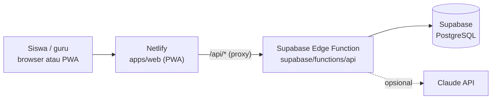

# Deployment: Netlify (frontend) + Supabase (backend & database)



- **Netlify** menyajikan PWA dan meneruskan `/api/*` ke Supabase (`netlify.toml`). Situs tetap satu domain: tanpa masalah CORS, dan cache offline tetap jalan.
- **Supabase Edge Function `api`** adalah backend (TypeScript, Deno). Endpoint dan JSON-nya sama dengan backend FastAPI sebelumnya, jadi frontend tidak berubah.
- **Supabase Postgres** menyimpan data. Tabel dibuat dari `supabase/migrations/` (bukan `create_all`). Semua tabel memakai RLS tanpa policy, jadi data siswa tidak bisa dibaca lewat Data API publik Supabase; hanya Edge Function yang mengaksesnya.

Supabase Edge Functions hanya menjalankan TypeScript, bukan Python. Karena itu backend Python (`apps/api`) diporting ke `supabase/functions/api`:

| Python (lama) | TypeScript (Supabase) |
|---|---|
| SymPy di `mathparse.py`, `step_checker.py`, `step_builder.py` | `math/frac.ts` (pecahan eksak BigInt), `math/mathparse.ts`, `services/step_checker.ts`, `services/step_builder.ts` |
| FastAPI + SQLAlchemy | Hono + postgres.js |
| `anthropic` (`messages.parse` + Pydantic) | `@anthropic-ai/sdk` (`messages.parse` + Zod), prompt dan model sama |

Kesetaraan diuji otomatis terhadap versi Python: 228 soal (konten dan varian tiap metode) identik, 46.677 jawaban contoh menghasilkan penilaian dan kode kesalahan yang sama, dan 37 permintaan API menghasilkan status dan bentuk JSON yang sama.

---

## 1. Supabase: proyek dan database

1. Daftar di <https://supabase.com> (bisa dengan akun GitHub) → **New project** → nama `langkahku`, region **Southeast Asia (Singapore)**. Simpan password database di tempat aman.
2. Catat **Project ref** (Project Settings → General), misalnya `abcdefghijklmnopqrst`.
3. Dari folder repositori:

   ```bash
   npm install
   npx supabase login                               # sekali, lewat browser
   npx supabase link --project-ref <PROJECT_REF>    # meminta password database
   npm run db:push                                  # membuat tabel dari supabase/migrations/
   ```

## 2. Supabase: deploy backend (Edge Function `api`)

1. Atur secret (sekali; nilai tidak disimpan di repositori):

   ```bash
   npx supabase secrets set JWT_SECRET=<string-acak-minimal-32-karakter> SEED_DEMO=true
   # opsional, untuk Pemodel AI:
   npx supabase secrets set ANTHROPIC_API_KEY=<kunci> MODELER_TIMEOUT_SECONDS=20 MODELER_MONTHLY_BUDGET_USD=10
   ```

   String acak bisa dibuat dengan `node -e "console.log(require('crypto').randomBytes(36).toString('base64url'))"`.
   Koneksi database (`SUPABASE_DB_URL`) disediakan Supabase secara otomatis.
2. Deploy:

   ```bash
   npm run api:deploy
   ```

   Perintah ini membundel `content/` ke dalam fungsi, lalu menjalankan `supabase functions deploy api --no-verify-jwt`. Aplikasi memakai login sendiri (JWT), bukan Supabase Auth, jadi pemeriksaan JWT bawaan Supabase dimatikan untuk fungsi ini.
3. Cek di browser: `https://<PROJECT_REF>.supabase.co/functions/v1/api/v1/health` → `{"ok":true,...}`. Akun demo dibuat pada permintaan pertama.
4. Ganti `GANTI-PROJECT-REF` di `netlify.toml` (bagian `[[redirects]] from = "/api/*"`) dengan project ref, lalu commit dan push.

> Konten (`content/`) ikut dibundel saat deploy. Setelah mengubah materi atau soal, jalankan lagi `npm run api:deploy`.

## 3. Netlify: deploy frontend

1. Daftar di <https://app.netlify.com> dengan akun GitHub.
2. **Add new site → Import an existing project → GitHub** → pilih repositori.
3. Netlify membaca `netlify.toml` (base `apps/web`, perintah `npm ci && npm run build`, folder `dist`). Tidak perlu mengisi apa pun, klik **Deploy**.
4. (Opsional) **Site configuration → Change site name** → misalnya `langkahku` → `https://langkahku.netlify.app`. Bila frontend memanggil API langsung (tanpa proxy), isi `CORS_ORIGINS` dengan alamat ini: `npx supabase secrets set CORS_ORIGINS=https://langkahku.netlify.app`.

## 4. Uji setelah deploy

1. Buka situs Netlify → masuk dengan akun demo **siswa / siswa123** atau **guru / guru123**.
2. Buka satu modul, kerjakan satu soal, lalu cek **Kemajuan** → poin bertambah (data tersimpan di Supabase).
3. Di HP: buka situs di Chrome → **Pasang aplikasi**; di iPhone: Safari → Bagikan → **Tambah ke Layar Utama**.

## Pengembangan lokal

```bash
npm run api:test      # 35 tes (matematika, pemodel, API) di Postgres sementara (PGlite), tanpa Claude API
npm run api:typecheck # TypeScript strict
npm run api:dev       # API di http://localhost:8000, memakai DATABASE_URL dari .env.local
cd apps/web && npm run dev   # frontend :5173, /api diteruskan ke :8000
```

Untuk `api:dev`, isi `DATABASE_URL` di `.env.local` dengan connection string Supabase (Project Settings → Database → **Session pooler**). Perhatian: itu database produksi. Untuk mencoba-coba tanpa menyentuh data produksi, buat proyek Supabase kedua khusus pengembangan.

## 5. Sebelum dipakai siswa sungguhan

- `npx supabase secrets set SEED_DEMO=false` (akun demo memakai password yang diketahui umum), atau segera ganti password akun demo.
- Baca [10-SECURITY-PRIVACY.md](10-SECURITY-PRIVACY.md): persetujuan orang tua, kebijakan privasi, dan pengungkapan pemakaian AI.
- Perubahan skema selalu lewat file baru di `supabase/migrations/` (`npx supabase migration new <nama>`), lalu `npm run db:push`.

## Batasan paket gratis

| Layanan | Batasan | Dampak |
|---|---|---|
| Supabase Free | Proyek dijeda setelah 7 hari tanpa aktivitas | Aktifkan lagi lewat dashboard (Restore); data tetap ada |
| Supabase Free | 500 MB database, 500 ribu pemanggilan Edge Function/bulan | Cukup untuk beberapa kelas |
| Supabase Edge Function | Waktu CPU terbatas per permintaan | Password di-hash dengan bcrypt cost 10 agar tetap di bawah batas |
| Netlify proxy | Batas waktu 26 detik per permintaan | Pemodel AI diberi batas 20 detik (`MODELER_TIMEOUT_SECONDS`) |

## Pemecahan masalah

| Gejala | Penyebab & solusi |
|---|---|
| Health menjawab error 500, log fungsi: `JWT_SECRET must be set` | Secret belum diisi → `npx supabase secrets set JWT_SECRET=...` |
| Health menjawab `401 Missing authorization header` | Fungsi ter-deploy dengan pemeriksaan JWT → deploy ulang dengan `npm run api:deploy` (memakai `--no-verify-jwt`) |
| Error `relation "users" does not exist` di log | Migrasi belum dijalankan → `npm run db:push` |
| Login gagal "Server sedang dinyalakan" | Alamat proxy di `netlify.toml` masih `GANTI-PROJECT-REF` atau salah → samakan, commit, push |
| Materi baru tidak muncul | Konten dibundel saat deploy → `npm run api:deploy` |
| Perubahan tidak muncul di HP | PWA memakai cache; tutup lalu buka lagi aplikasinya (pembaruan dipasang otomatis) |

Log fungsi: Supabase Dashboard → Edge Functions → `api` → **Logs**.
