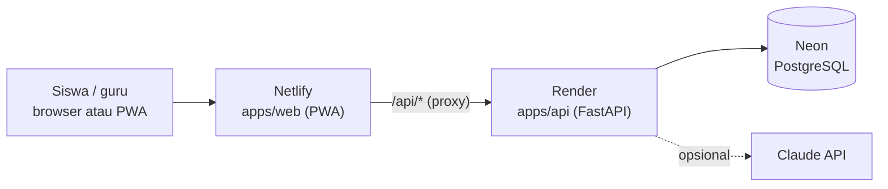

# Deployment: Netlify (frontend) + Render (backend) + Neon (database)



- **Netlify** menyajikan PWA dan meneruskan `/api/*` ke Render (`netlify.toml`). Situs tetap satu domain: tanpa masalah CORS, dan cache offline tetap jalan.
- **Render** menjalankan FastAPI dari `render.yaml` (paket gratis, region Singapura).
- **Neon** menyimpan data. Disk Render gratis terhapus setiap deploy, jadi SQLite tidak bisa dipakai di produksi (server menolak berjalan bila `DATABASE_URL` masih SQLite).

Semua layanan di bawah punya paket gratis. Deploy terjadi otomatis setiap kali ada `git push` ke GitHub.

---

## 1. Neon: database

Proyek Neon sudah tertaut ke repositori ini lewat CLI Neon (`neon.ts`, `.neon`; cabang `production`, region Singapura, PostgreSQL 18):

```bash
npm i -g neon@latest
neon login          # sekali, lewat browser
neon deploy         # menerapkan neon.ts dan menulis variabel Neon ke .env.local (tidak di-commit)
```

Backend membaca `.env.local` otomatis. Dua variabel yang dipakai:

| Variabel | Jenis koneksi | Dipakai untuk |
|---|---|---|
| `DATABASE_URL` | **Pooled** (host berakhiran `-pooler`) | Semua permintaan aplikasi |
| `DATABASE_URL_UNPOOLED` | **Direct** | Membuat/mengubah tabel saat server mulai (anjuran Neon untuk perubahan skema) |

Untuk Render, salin kedua nilai itu dari `.env.local` (atau Neon Console → **Connect**) tanpa membagikannya di tempat lain. Tabel dibuat otomatis saat backend pertama kali berjalan.

> **Perhatian:** dengan `.env.local`, server **lokal** juga tersambung ke cabang `production`. Untuk mencoba-coba tanpa mengubah data produksi, buat cabang pengembangan: `neon checkout dev --create` lalu `neon deploy` (cabang dev kedaluwarsa otomatis 7 hari, sesuai `neon.ts`). Tes otomatis (`pytest`) selalu memakai SQLite sementara dan tidak menyentuh Neon.

## 2. Render: deploy backend

1. Daftar di <https://render.com> dengan akun GitHub, beri akses ke repositori `2225250026_Riki_Agil_Saputra`.
2. **New → Blueprint** → pilih repositori → Render membaca `render.yaml` dan membuat layanan **`langkahku-api`**.
3. Isi variabel yang diminta (`sync: false`):

   | Variabel | Isi |
   |---|---|
   | `DATABASE_URL` | Connection string Neon **pooled** dari langkah 1 |
   | `DATABASE_URL_UNPOOLED` | Connection string Neon **direct** dari langkah 1 |
   | `CORS_ORIGINS` | URL Netlify, misalnya `https://langkahku.netlify.app` (boleh dikosongkan karena lewat proxy) |
   | `ANTHROPIC_API_KEY` | Opsional, untuk Pemodel AI. Kosongkan bila belum dipakai |

   `JWT_SECRET` dibuat otomatis oleh Render.
4. **Apply** → tunggu build selesai (±3–5 menit).
5. Catat URL layanan, misalnya `https://langkahku-api.onrender.com`. Cek di browser:
   `https://langkahku-api.onrender.com/api/v1/health` → `{"ok": true, ...}`

> Jika Render memberi URL lain (nama sudah dipakai orang), ganti alamat di `netlify.toml` bagian `[[redirects]] from = "/api/*"`, lalu commit dan push.

## 3. Netlify: deploy frontend

1. Daftar di <https://app.netlify.com> dengan akun GitHub.
2. **Add new site → Import an existing project → GitHub** → pilih repositori.
3. Netlify membaca `netlify.toml` (base `apps/web`, perintah `npm ci && npm run build`, folder `dist`). Tidak perlu mengisi apa pun, klik **Deploy**.
4. (Opsional) **Site configuration → Change site name** → misalnya `langkahku` → alamat menjadi `https://langkahku.netlify.app`. Masukkan alamat ini ke `CORS_ORIGINS` di Render.

## 4. Uji setelah deploy

1. Buka situs Netlify → masuk dengan akun demo **siswa / siswa123** atau **guru / guru123**.
   Permintaan pertama setelah server lama diam bisa memakan ±1 menit (server gratis Render "tidur"); aplikasi menampilkan "Server sedang dinyalakan…" dan mencoba ulang otomatis.
2. Buka satu modul, kerjakan satu soal, lalu cek **Kemajuan** → poin bertambah (berarti data tersimpan di Neon).
3. Di HP: buka situs di Chrome → **Pasang aplikasi**; di iPhone: Safari → Bagikan → **Tambah ke Layar Utama**.

## 5. Sebelum dipakai siswa sungguhan

- Ubah `SEED_DEMO` menjadi `false` di Render (akun demo memakai password yang diketahui umum), atau segera ganti password akun demo.
- Baca [10-SECURITY-PRIVACY.md](10-SECURITY-PRIVACY.md): persetujuan orang tua, kebijakan privasi, dan pengungkapan pemakaian AI.
- Ganti `create_all` dengan migrasi Alembic dan pertimbangkan refresh token (lihat "Perbedaan v0.1" di [CLAUDE.md](../CLAUDE.md)).

## Batasan paket gratis

| Layanan | Batasan | Dampak |
|---|---|---|
| Render Free | Server tidur setelah 15 menit tanpa akses; bangun ±50 detik | Akses pertama lambat; aplikasi mencoba ulang otomatis |
| Render Free | 750 jam/bulan | Cukup untuk satu layanan yang menyala terus |
| Netlify proxy | Batas waktu 26 detik per permintaan | Pemodel AI diberi batas 20 detik (`MODELER_TIMEOUT_SECONDS`) |
| Neon Free | 0,5 GB penyimpanan, komputasi tidur saat idle | Cukup untuk beberapa kelas; bangun cepat (< 1 detik) |

## Pemecahan masalah

| Gejala | Penyebab & solusi |
|---|---|
| Deploy Render gagal: `DATABASE_URL must point to PostgreSQL` | `DATABASE_URL` belum diisi di Render → isi connection string Neon |
| Deploy Render gagal: `JWT_SECRET must be set` | Variabel terhapus → isi string acak ≥ 32 karakter |
| Situs terbuka tetapi login selalu gagal "Server sedang dinyalakan" | Alamat proxy di `netlify.toml` tidak sama dengan URL Render → samakan, commit, push |
| Error `password authentication failed` di log Render | Connection string Neon salah atau password sudah di-reset → salin ulang dari Neon |
| Perubahan tidak muncul di HP | PWA memakai cache; tutup lalu buka lagi aplikasinya (pembaruan dipasang otomatis) |
